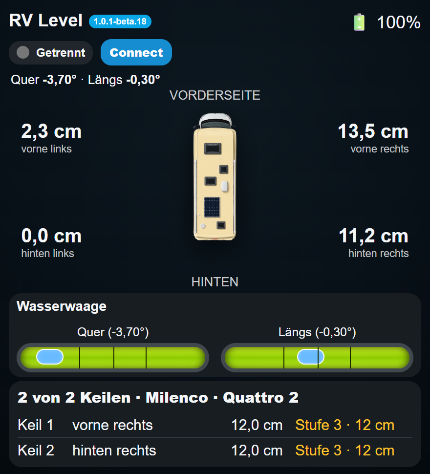
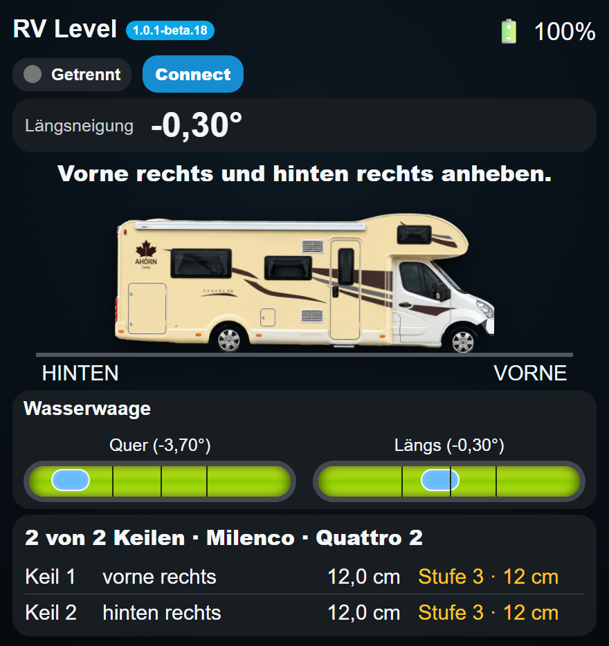
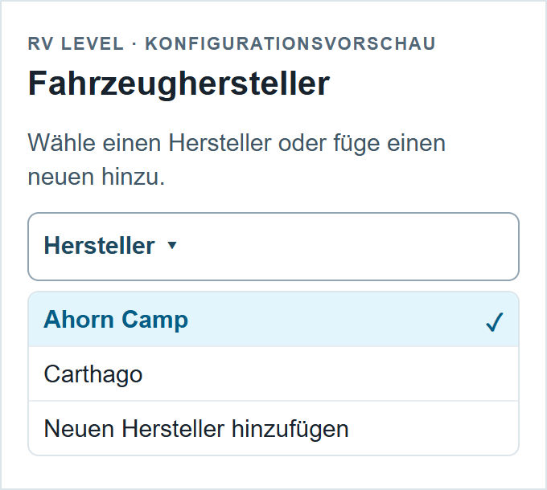
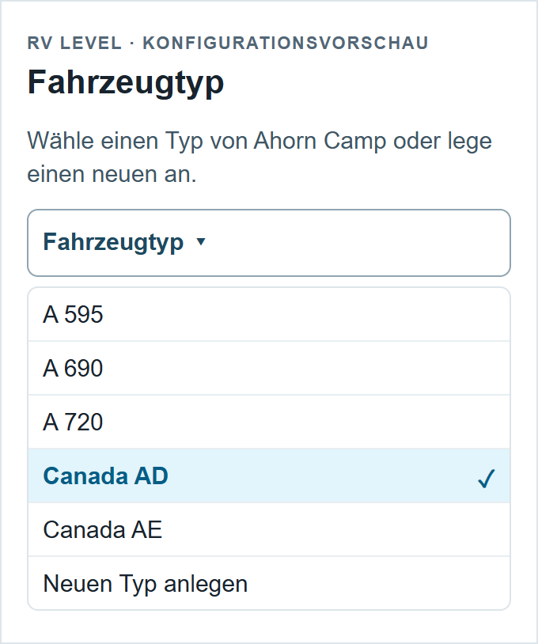
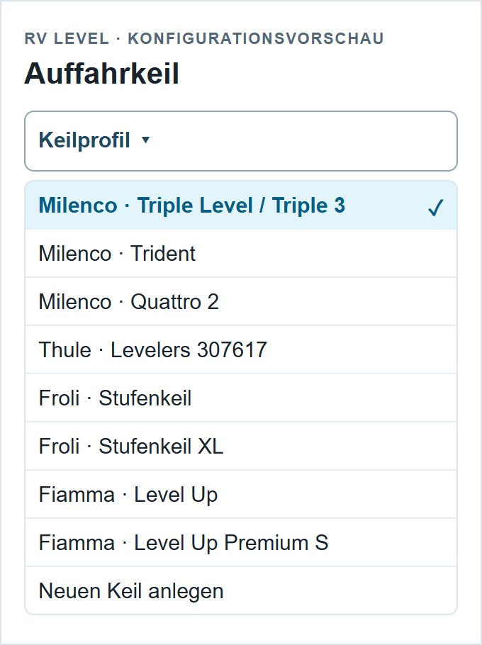

# RV Level Sensor for Home Assistant

Home-Assistant-Integration mit Dashboard-Karten für kompatible **RVLevel-Bluetooth-Nivelliersensoren**. Das Projekt ist nicht auf eine einzelne Handelsmarke beschränkt und ist für den von uns verwendeten **Xparkle RV Level Sensor** sowie den **RV Level Sensor von Fritz Berger** vorgesehen, sofern das Gerät das unterstützte RVLevel-BLE-Protokoll (`RVLevel-*`, Service UUID `FFF0`) verwendet.

> Aktuelle Version dieses Forks: **v1.0.1-beta.18**.
> Ursprüngliches Projekt: [schmidtbenjamin91-web/rv-level-sensor](https://github.com/schmidtbenjamin91-web/rv-level-sensor).

## Funktionen

- lokale Bluetooth-Verbindung in Home Assistant
- Quer- und Längsneigung
- berechnete Höhendifferenz an den Rädern
- Draufsicht und Seitenansicht
- Wasserwaagen-Anzeige
- Auffahrkeil-Empfehlungen
- Fahrzeugprofile und Modelljahre
- Ahorn-Camp-Profile 2019–2026
- Canada AD 2019 mit eigener Originalgrafik
- automatische Bereitstellung und Registrierung der Dashboard-Karte
- automatische Erkennung des passenden Entity-Prefix
- einstellbare Sensorausrichtung: **Normal** oder **180° gedreht**

## Screenshots

### Dashboard

<table>
  <tr>
    <td align="center"><strong>Draufsicht</strong></td>
    <td align="center"><strong>Seitenansicht</strong></td>
  </tr>
  <tr>
    <td></td>
    <td></td>
  </tr>
</table>

Die Dashboard-Karte zeigt Quer- und Längsneigung, die berechneten Anhebehöhen, eine Wasserwaagen-Darstellung sowie die passende Auffahrkeil-Empfehlung.

### Konfiguration

<table>
  <tr>
    <td align="center"><strong>Hersteller</strong></td>
    <td align="center"><strong>Fahrzeugmodell</strong></td>
    <td align="center"><strong>Auffahrkeile</strong></td>
  </tr>
  <tr>
    <td></td>
    <td></td>
    <td></td>
  </tr>
</table>

Die Konfiguration ist für eine spätere Erweiterung um weitere Fahrzeughersteller ausgelegt. Für hinterlegte Fahrzeugprofile werden Radstand und Spurweite automatisch verwendet. Ab **v1.0.1-beta.5** kann zusätzlich die **Sensorausrichtung** auf **Normal** oder **180° gedreht** gestellt werden. Bei 180° werden Vorder-/Hinterachse sowie Links/Rechts für Winkel, Radhöhen und Keilempfehlungen entsprechend korrigiert.

## Voraussetzungen

- Home Assistant mit Bluetooth-Unterstützung oder Bluetooth Proxy
- kompatibler RVLevel-Sensor in Bluetooth-Reichweite
- HACS für die empfohlene Installation

## Installation über HACS

1. In Home Assistant **HACS → Integrationen** öffnen.
2. Über das Menü **Benutzerdefinierte Repositories** öffnen.
3. Repository eintragen: `https://github.com/Hulki24/rv-level-sensor`
4. Kategorie **Integration** wählen.
5. **RV Level Sensor** installieren.
6. Home Assistant vollständig neu starten.
7. **Einstellungen → Geräte & Dienste → Integration hinzufügen → RV Level Sensor** öffnen.
8. Sensor einschalten und das gefundene `RVLevel-*`-Gerät auswählen.

### Dashboard-Ressource

Ab v1.0.1 wird die JavaScript-Karte bei Lovelace im Storage-Modus automatisch als Modul-Ressource registriert. Die Integration stellt die Dateien unter `/rv-level-sensor/` bereit. Ein manueller Ressourcen-Eintrag ist bei einer normalen HACS-Installation nicht erforderlich.

Wer von Alpha 9.7.8 oder älter kommt, sollte den alten manuellen Eintrag wie `/local/xparkle-rv-level-card.js?v=978` einmalig entfernen, damit die Karte nicht doppelt geladen wird.

## Dashboard-Karten

Ab **v1.0.1-beta.3** wird der passende Entity-Prefix automatisch erkannt. Bei einer normalen Installation ist deshalb kein `entity_prefix` mehr nötig.

Hauptansicht:

```yaml
type: custom:xparkle-rv-level-card
```

Draufsicht:

```yaml
type: custom:xparkle-rv-level-top-card
```

Seitenansicht:

```yaml
type: custom:xparkle-rv-level-side-card
```

Falls die automatische Erkennung in einer speziellen Installation nicht möglich ist, kann der Prefix weiterhin manuell angegeben werden, zum Beispiel:

```yaml
type: custom:xparkle-rv-level-card
entity_prefix: sensor.rvlevel_410f
```

Die bestehenden Entity-IDs und der interne Integrations-Domainname `xparkle_rvlevel` bleiben in der v1-Serie bewusst erhalten, damit bestehende Alpha-Installationen ohne Migration weiterlaufen.

## Unterstützte Sensoren

Die automatische Erkennung erwartet derzeit Bluetooth-Geräte mit einem Namen `RVLevel-*` und der Service-UUID `0000fff0-0000-1000-8000-00805f9b34fb`. Handelsname und Gehäuse können abweichen. Falls ein Fritz-Berger-Gerät mit abweichendem Bluetooth-Namen oder einer anderen UUID ausgeliefert wird, bitte ein GitHub-Issue mit den Bluetooth-Informationen erstellen; dann kann das Profil ergänzt werden.

## Fahrzeugprofile

Die Fahrzeugauswahl ist hierarchisch aufgebaut: **Hersteller → Modell → Modelljahr → Auffahrkeil**. Dadurch können später weitere Hersteller wie Knaus, Hymer oder Dethleffs ergänzt werden.

Für die Darstellung gilt in der v1-Serie: **Canada AD 2019** behält die eigene Referenzgrafik. Alle anderen derzeit hinterlegten Fahrzeuge verwenden den gemeinsamen Fahrzeuggrafiksatz. In der Draufsicht ist vorne oben und hinten unten.

## Updates

Neue Versionen werden als GitHub Releases veröffentlicht, z. B. `v1.0.1`, `v1.1.0`. HACS erkennt neue Releases und kann die Integration aktualisieren. Durch die Versionskennung der automatisch geladenen Karte wird bei einem Release ein neuer Frontend-Pfad geladen, ohne dass der Benutzer die Dashboard-Ressource manuell ändern muss.

## Fehler melden

Issues: `https://github.com/schmidtbenjamin91-web/rv-level-sensor/issues`

Bitte Home-Assistant-Version, Sensor-Modell/Handelsname, Bluetooth-Gerätename und relevante Log-Ausgaben angeben. Keine privaten Zugangsdaten posten.

## Hinweis

Dies ist ein Community-Projekt und keine offizielle Integration von Xparkle, Fritz Berger, Ahorn Camp oder Home Assistant. Marken- und Produktnamen dienen nur der Kompatibilitätsbeschreibung.

## Montagewand (Fork)

Für den Berger SmartLevel kann die Montagewand in den Integrationsoptionen ausgewählt werden:
**in Fahrtrichtung rechts**, **links**, **vorne** oder **hinten**.
Voraussetzung: senkrechte Wand, Schriftzug aufrecht, Sensorvorderseite zum Innenraum.
Die Auswahl bezeichnet die Wand, nicht die Blickrichtung der Sensorfront.

Die rechte Wand entspricht der bisher funktionierenden Einstellung **180° gedreht**,
die linke Wand der bisherigen Einstellung **Normal**. Bestehende Einstellungen bleiben
bis zum Speichern neuer Optionen wirksam. Vorne/hinten tauschen die Achsen und passen
das Vorzeichen an. Alle Winkel, Radhöhen und Keilempfehlungen verwenden diese Korrektur.

Die [Berger-Anleitung](https://fbr.etailercdn.de/media/org/orgb_S/orgid_21221/1946738_501_898383.pdf)
nennt die App **Berger SmartLevel** und vier Installationsrichtungen. Sie dokumentiert
keine BLE-Achsen oder Vorzeichen. Die Zuordnung hier basiert auf der beobachteten
rechten Wandmontage; die übrigen Wände sind daraus geometrisch abgeleitet und noch
am echten Sensor zu prüfen. Es wird keine Einstellung in die Sensor-Firmware geschrieben.

Nach der Auswahl prüfen: Front höher ergibt positive Längsneigung, rechte Seite höher
positive Querneigung. Bei Front-/Heckwand zusätzlich prüfen, dass die Achsen nicht vertauscht
angezeigt werden. Ein vorhandener Nullabgleich der App wird dadurch nicht ersetzt.

## Planung mit maximal zwei Keilen (Fork beta.6)

Die Integration vergleicht alle Radpaare sowie einzelne Keile und die Variante ohne
Keil. Verwendet werden ausschließlich die festen Stufen des gewählten Keilprofils.
Gewählt wird die Kombination mit der kleinsten Summe der quadrierten Restwinkel
für Längs- und Querneigung. Bei gleichem Ergebnis werden geringere Verwindung,
weniger Keile und geringere Gesamthöhe bevorzugt.

Ab beta.8 zeigen die Zahlen am Fahrzeug wieder die ursprünglichen **theoretischen
Anhebehöhen je Rad**. Sie sind aus den Winkeln berechnet und keine direkt gemessenen
Abstände. Der Bezug ist die höchste Ecke, nicht die Fahrzeugmitte.
Der Zwei-Keil-Plan mit tatsächlich verfügbaren Stufen steht getrennt darunter.
Die theoretischen Sensoren „… anheben“
bleiben als separate geometrische Vier-Rad-Korrektur erhalten. Die Sensoren
„Keil …“, die Keilempfehlung und beide Karten verwenden denselben Zwei-Keil-Plan.
Die bisherigen „Milenco …“-Entitäten behalten ihre IDs, nennen aber die Stufe
des tatsächlich ausgewählten Keilprofils.

Die Restneigung ist eine **Modellschätzung** aus einer Ebene durch die vier
Radaufstandspunkte mit gleicher Gewichtung. Federung, Reifen und Boden sind
nicht modelliert; insbesondere unterschiedliche Stufen können die Federung
verschränken. Das Ergebnis deshalb während des Ausrichtens live kontrollieren.

### Aktualisierung zum Testen

Den vollständigen Ordner custom_components/xparkle_rvlevel dieses Branches
ersetzen, Home Assistant vollständig neu starten und die Browserseite neu laden.
Die automatisch registrierte Kartenressource erhält den neuen Versionsparameter
1.0.1-beta.6; die Karte zeigt dieselbe Versionskennung. Bei manuell verwalteten
Ressourcen den Versionsparameter entsprechend aktualisieren. Nur die JavaScript-
Ressource auszutauschen reicht nicht, da der Plan in Python berechnet wird.

Prüfungen: python -m unittest discover -s tests -v und node tests/test_card.cjs.

### Fork beta.7

Aktuelle relative Radhöhen am Fahrzeug, Zwei-Keil-Plan separat darunter.
Das Xparkle-Logo ist aus beiden Karten entfernt. Versionskennung und
Ressourcenparameter sind 1.0.1-beta.7. Die Zwei-Keil-Berechnung ist unverändert.

### Fork beta.8

Die vier ursprünglichen theoretischen Anhebewerte sind wiederhergestellt.
Beta.7 hatte stattdessen relative Höhen zur Fahrzeugmitte angezeigt; das war ein
anderer Bezug und führte zu anderen Zahlen bei gleicher Fahrzeugneigung.
Winkelberechnung und Zwei-Keil-Optimierung bleiben unverändert.

### Fork beta.9

Milenco Quattro 2: Stufen korrigiert auf 4 / 8 / 12 / 18 cm entsprechend
[Fritz Berger](https://www.fritz-berger.de/artikel/milenco-quattro-auffahrkeile-4-stufig-2er-set-323862).
Dadurch kann sich der optimale Zwei-Keil-Plan ändern.

Die Winkelsensoren enthalten jetzt Diagnoseattribute: empfangenes FFF2-Paket,
vorzeichenbehaftete Rohzahlen, Winkel vor Montagekorrektur und Montageoption.
Die Dekodierung bleibt unverändert: Bytes 1–2 bzw. 4–5, signed big-endian,
geteilt durch 100. Diese Protokollannahme stammt aus den bisherigen
Referenzmessungen, nicht aus einer veröffentlichten Berger-Protokollspezifikation.
Keine Glättung hinzugefügt. Bei identischem Paket und gleicher Montageoption
muss der Winkel identisch bleiben. Der Vergleich mit Berger SmartLevel und
Rohpaketen kann Sensoränderungen von einer anderen App-Verarbeitung unterscheiden.

### Fork beta.10: getrennte Spurweiten

In Fahrzeug & Auffahrkeile sind Spurweite vorne, das Häkchen
„Spurweite vorne und hinten gleich“ und Spurweite hinten einstellbar.
Einheit: Meter, gemessen von Radmitte zu Radmitte. Für das hier getestete
Fahrzeug vorne 1,81 m und hinten 1,98 m eintragen und das Häkchen entfernen.
Das hintere Feld bleibt sichtbar; bei gesetztem Häkchen wird vorne für beide
Achsen verwendet. Profile überschreiben manuell eingetragene Spurweiten nicht.
Alte Konfigurationen verwenden ohne Änderung weiterhin denselben Wert für beide.

Die vier physischen Radhöhen werden aus Radstand und der jeweiligen Spurweite
berechnet; die Anhebekorrektur bezieht sich auf die höchste Ecke. Der
Zwei-Keil-Plan passt die Ebene an die tatsächlichen vier Radpositionen an.
Bei reiner Querneigung können daher auch links vorne und links hinten
unterschiedliche relative Höhen haben. Die Winkeldekodierung bleibt unverändert.
Der Sensor „Querkorrektur“ zeigt den größeren der beiden seitlichen
Höhenunterschiede. „Berechnungsbreite“ bleibt aus Kompatibilität die Spurweite
vorne; ein zusätzlicher Diagnosesensor zeigt die effektive Spurweite hinten.

### Fork beta.11: eigene Fahrzeuge und Bilder

Unter Konfigurieren zuerst einen Hersteller wählen. Danach einen vorhandenen
Fahrzeugtyp auswählen oder „Neuen Typ anlegen“ wählen. Über „Neuen Hersteller
hinzufügen“ lässt sich eine weitere Marke mit ihrem ersten Typ speichern.
Ahorn-Serienmodelle behalten die Baujahrauswahl. Ältere eigene Profile ohne
Hersteller stehen unter „Benutzerdefiniert“ und lassen sich beim Bearbeiten
einem Hersteller zuordnen. Maße und Bilder bleiben pro Typ gespeichert.

Jedes Fahrzeug enthält einen Namen, Radstand, Spurweiten vorne/hinten samt
Gleichheits-Häkchen, optionale Gesamtlänge/-breite/-höhe (0 = nicht angegeben)
und je ein Bild für Drauf- und Seitenansicht. Gesamtabmessungen werden gespeichert,
die Nivellierung rechnet weiterhin mit Radstand und Spurweiten.

Bilder werden als HA-Pfad oder HTTP(S)-Bild-URL eingetragen. Beispiel:
- Datei: /config/www/womo/adria-top.png → Bildpfad: /local/womo/adria-top.png
- Datei: /config/www/womo/adria-side.png → Bildpfad: /local/womo/adria-side.png

Dateien können über einen vorhandenen Dateieditor oder eine Dateifreigabe nach
/config/www kopiert werden. Ein direkter Datei-Upload im Integrationsdialog
ist nicht enthalten. Die Zuordnung von www zu /local beschreibt die
[HA-Dokumentation](https://www.home-assistant.io/integrations/http/#hosting-files).
Wenn www erstmals neu erstellt wird, Home Assistant neu starten.

Draufsicht: Fahrzeugfront oben. Seitenansicht: Fahrzeugfront rechts.
Bilder mit transparentem Rand eignen sich für die dunkle Karte.
Ohne eigenes Bild oder bei einem Ladefehler erscheint die Standardgrafik.
Bei Bildänderungen unter demselben Dateinamen kann ein neuer Name oder ein
Versionsparameter (z.B. /local/womo/adria-top.png?v=2) den Browsercache umgehen.

Bestehende benutzerdefinierte Maße bleiben beim Öffnen erhalten. Erst beim
Speichern wird dieses Fahrzeug zu einem benannten persönlichen Profil.
Die Dateien im Integrationsordner werden bei Updates ersetzt; eigene Bilder
deshalb im www-Ordner ablegen.
